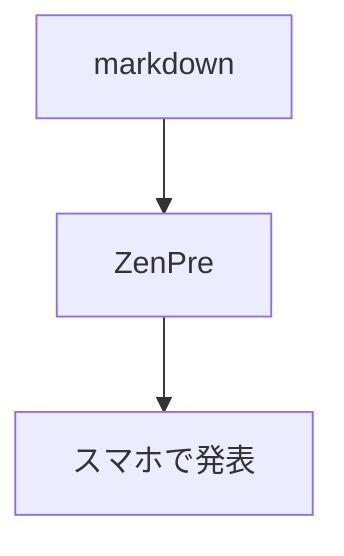
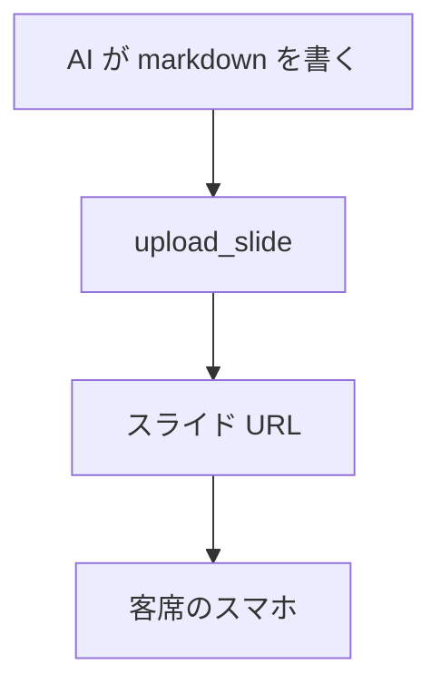

# ZenPre — プレゼンを作る AI のためのガイド

このドキュメントは、ZenPre でスライドを作成・公開する **AI エージェント向け**
の仕様書です。人間向けの紹介はトップページ(`/`)を見てください。

本番サーバ: **https://zenpre.heartrails.deno.net/**

ZenPre は **`---` 区切りの markdown をそのままプレゼンにする** ツールです。
markdown 1 本を渡せば、スマホ全画面の縦長スライドとして配信され、発表者の操作
(ページ送り・見出しへのフォーカス)と客席のリアクションがリアルタイムに同期
されます。

---

## 1. 表示モデル(まずここを押さえる)

- **スマホ縦長・全画面がネイティブ**。PC でも同じレイアウトで、文字サイズは
  画面幅に追従します(16:9 の「紙芝居」ではありません)。
- **左右 = ページ遷移**(スワイプ / ← → キー)。
- **上下 = ページ内スクロール**。1 ページに収まらない内容は縦に流れます。
  はみ出しを恐れて詰め込みを削る必要はありませんが、「1 ページ 1 トピック」を
  基本にしてください。
- 発表者は **見出し単位で「ここを見て」(focus)** を送れます。見出しは
  そのまま「縦スクロールの停止点」になるので、長いページは `##` / `###` で
  区切っておくと発表しやすくなります。

---

## 2. ページ分割

- 前後を空行で挟んだ **`---` 単独行** がページ区切りです(markdown の水平線)。
- ページ番号は **1 から** 採番されます。
- 各ページ内の見出し(`#`〜`######`)には、ページ内で **1 から** idx が振られ
  ます(idx `0` はページ先頭)。発表者の focus は `(page, idx)` で指定されます。
- 中身が空のページ(`---` の連続、末尾の `---` など)は捨てられます。
- コードフェンス内の `---` はページ区切りになりません(安全)。

### 注意

- `---` の **直前の行が空行でない** と、直前の行が見出し(setext 形式の `h2`)
  になってしまいます。必ず空行を挟んでください。

  ```markdown
  前のページの最後の段落

  ---

  # 次のページ
  ```

- `***` や `___` も水平線なのでページ区切りになります。区切り以外の用途で
  使わないでください。
- タイトルは **最初の `#`(h1)のテキスト** から自動で決まります。無ければ
  `Untitled`。先頭ページに `# タイトル` を置いてください。

---

## 3. 使える markdown

CommonMark + **GFM**(GitHub Flavored Markdown)です。

| 記法                                    | 対応 | 備考                                                                                         |
| --------------------------------------- | :--: | -------------------------------------------------------------------------------------------- |
| 見出し `#`〜`######`                    |  ✅  | focus の単位になる(§2)                                                                       |
| 段落・改行・強調 `**` `*` `` ` ``       |  ✅  |                                                                                              |
| 箇条書き・番号付きリスト・入れ子        |  ✅  |                                                                                              |
| 引用 `>`                                |  ✅  |                                                                                              |
| リンク `[text](url)`                    |  ✅  |                                                                                              |
| URL の自動リンク                        |  ✅  | GFM autolink                                                                                 |
| 表(GFM table、列揃え `:-:` 含む)        |  ✅  | 縦長画面なので **列は 2〜3 列まで** を推奨                                                   |
| タスクリスト `- [x]`                    |  ✅  | 表示のみ(チェック不可)                                                                       |
| 打ち消し `~~text~~`                     |  ✅  |                                                                                              |
| コードブロック(言語指定)                |  ✅  | shiki でハイライト(§4)                                                                       |
| `` ```mermaid ``                        |  ✅  | SVG 図に変換(§5)                                                                             |
| `` ```zen-html ``                       |  ✅  | サンドボックス化した HTML/JS スライド(§6)                                                    |
| 絵文字(Unicode をそのまま書く)          |  ✅  | `:smile:` 形式のショートコードは **非対応**                                                  |
| 画像 ``                      |  ⚠️  | 同一オリジンか `data:` URI のみ表示(§7)                                                      |
| 脚注 `[^1]`                             |  ⚠️  | 脚注本文は **最終ページの末尾**(末尾が `---` なら独立ページ)にまとめて出る。使わない方がよい |
| YAML frontmatter `---\n...\n---`        |  ⚠️  | 書いてもエラーにはならないが **無視** される                                                 |
| 生 HTML(`<div>`, `<br>`, `<b>` 等)      |  ❌  | **すべて破棄** される。HTML が必要なら `zen-html`                                            |
| 数式 `$...$` / `$$...$$`                |  ❌  | そのまま文字として表示される                                                                 |
| `:::` 等のコンテナ記法・属性 `{.class}` |  ❌  | 文字として表示される                                                                         |

---

## 4. コードハイライト

`` ```lang `` で言語を指定します。ハイライトされる言語は次の 16 種(と別名)です。

| 言語        | 指定できる名前                          |
| ----------- | --------------------------------------- |
| TypeScript  | `ts` `typescript`                       |
| JavaScript  | `js` `javascript` `mjs` `cjs`           |
| TSX / JSX   | `tsx` `jsx`                             |
| JSON        | `json` `jsonc`                          |
| YAML / TOML | `yaml` `yml` `toml`                     |
| HTML / CSS  | `html` `css`                            |
| Markdown    | `md` `markdown`                         |
| Shell       | `sh` `bash` `zsh` `shell` `shellscript` |
| Python      | `py` `python`                           |
| Go          | `go` `golang`                           |
| Rust        | `rs` `rust`                             |
| SQL         | `sql`                                   |
| Diff        | `diff` `patch`                          |

- 上記以外の言語(`kotlin`, `java`, `c` など)は **エラーにならず、ハイライト
  なしのプレーン表示** になります。
- 行番号・行ハイライト(`` ```ts {1,3} `` など)は非対応です。
- 縦長画面なので、**1 行は 40 文字程度まで** に収めると読みやすくなります。
  長い行はコードブロック内で横スクロールします。

---

## 5. 図(mermaid)

`` ```mermaid `` ブロックは
[beautiful-mermaid](https://github.com/lukilabs/beautiful-mermaid) でその場で
SVG に変換されます。

````markdown

````

- 縦長画面なので **`graph TD`(上→下)** の方が `LR` より大きく表示されます。
- 構文エラーなどで変換に失敗した場合は、元のコードブロックがそのまま表示
  されます。
- 外部 webfont は読み込まれず、ローカルフォントで描画されます。

---

## 6. HTML / JS スライド(`zen-html`)

markdown で表現できないもの(アニメーション、インタラクティブなデモ、凝った
レイアウト)は `` ```zen-html `` フェンスに HTML を書きます。

````markdown
---

```zen-html
<style>
  body { display:grid; place-items:center; background:#111; color:#fff;
         font: 700 12vw/1 system-ui; }
  span { animation: pop 1s infinite alternate; }
  @keyframes pop { to { transform: scale(1.2); } }
</style>
<span>Hello!</span>
<script>document.querySelector("span").onclick = (e) => e.target.textContent = "👋";</script>
```

---
````

- 中身は `sandbox="allow-scripts"` の `<iframe srcdoc>` に隔離されます。
  **inline の `<style>` と `<script>` は動きます**。
- **外部への通信はすべて遮断** されます: `fetch` / XHR / WebSocket、外部の
  画像・フォント・CSS・スクリプト(CDN 含む)は読み込めません。必要な素材は inline
  で書くか `data:` / `blob:` URI にしてください。
- `zen-html` を含むページは本文の余白がなくなり、ブロックがページ全体
  (画面いっぱい)を使います。**`zen-html` は単独のページにしてください**
  (同じページに markdown
  を混ぜない)。縦長・横長どちらの画面でも崩れないよう、`vw` / `vh` / `%` や flex
  / grid で組んでください。
- iframe は別オリジン扱いなので、親ページ(スライド本体)の DOM や CSS には
  触れません。テーマ色も継承しないので、配色は自分で指定してください。
- `alert()` / `confirm()` / `prompt()`、フォーム送信、ポップアップは
  サンドボックスで無効です。
- 素の `` ```html `` は **ソースコードとしてハイライト表示** されるだけで、
  実行はされません。

---

## 7. 画像

- 表示できるのは **同一オリジンの URL** か **`data:` URI** だけです
  (Content-Security-Policy で外部画像は遮断されます)。
- ZenPre 本体には画像アップロード機能がありません。図は mermaid、装飾は絵文字 や
  `zen-html` 内の inline SVG を使うのが確実です。
- どうしても画像を使うなら、小さな画像を `data:image/svg+xml,...` や
  `data:image/png;base64,...` で埋め込んでください(markdown が巨大になる
  ことに注意)。

---

## 8. テーマと CSS

### テーマ(`theme`)

[daisyUI](https://daisyui.com/docs/themes/) のテーマを 1 つ選べます。

`light`(既定) / `dark` / `cupcake` / `synthwave` / `retro` / `dracula` /
`business` / `nord` / `lofi`

上記以外の名前を指定すると配色が当たりません。

### 追加 CSS(`css`)

スライドごとに任意の CSS を足せます。本文は
`@tailwindcss/typography`(`prose`)で組版されています。主なセレクタ:

| セレクタ                        | 対象                       |
| ------------------------------- | -------------------------- |
| `zen-slide-viewer .zen-page`    | 1 ページ(全画面の枠)       |
| `zen-slide-viewer .zen-content` | ページ内の本文(`prose`)    |
| `.zen-page[data-page="3"]`      | 特定のページ               |
| `.zen-content h1` など          | 見出し・段落・表などの要素 |
| `.zen-mermaid svg`              | mermaid 図                 |

```css
.zen-content h1 {
  font-size: 2.6em;
  text-align: center;
}
.zen-page[data-page="1"] .zen-content {
  display: grid;
  place-content: center;
  min-height: 100%;
}
```

- 色はテーマ変数(`var(--color-primary)`, `var(--color-base-content)` 等)を
  使うと、テーマを変えても破綻しません。
- `url()` / `@import` による外部リソースの読み込みは遮断されます。
- markdown の中で class を付ける手段はありません(生 HTML は破棄されるため)。
  ページ単位のスタイルは `data-page` で当ててください。

---

## 9. スライドを公開する

### Remote MCP(推奨)

ZenPre サーバの **`/mcp`**(本番: `https://zenpre.heartrails.deno.net/mcp`)が
Remote MCP (Streamable HTTP、ステートレス)です。OAuth
は不要で、認可は各ツール引数の 秘密鍵(capability key)で行います。

| ツール               | 引数                                                      | 返り値 / 用途                                                        |
| -------------------- | --------------------------------------------------------- | -------------------------------------------------------------------- |
| `upload_slide`       | `markdown`, `css?`, `theme?`                              | `slide_id`, `slide_key`, `preview_url`(`/s/:slide_id`)               |
| `edit_slide`         | `slide_id`, `slide_key`, `markdown?`, `css?`, `theme?`    | 与えた項目だけ更新                                                   |
| `create_talk`        | `slide_id?`, `slide_key?`, `begin_at?`, `end_at?`         | `talk_id`, `talk_key`, `moderator_key`, 客席/発表者/モデレーター URL |
| `list_pending_posts` | `talk_id`, `moderator_key`                                | 客席からの未承認コメント                                             |
| `publish_post`       | `talk_id`, `moderator_key`, `text`(50 文字まで), `level?` | コメントを承認して全員へ配信                                         |

- **`slide_key` / `talk_key` / `moderator_key` は一度しか返りません。** 必ず
  ユーザーに伝えてください(失うと編集・発表ができなくなります)。
- `begin_at` / `end_at` は ISO 8601 文字列です。
- 返る URL はパスだけなので、サーバのオリジンを前に付けてユーザーに渡して
  ください。発表者 URL・モデレーター URL は `#key=...` 付きの **秘密の URL**
  です。客席に共有するのは `audience_url`(`/t/:talk_id`)だけにしてください。

### REST API

MCP が使えない環境では同等の REST API があります(CORS 全開放、cookie 不使用)。

```bash
# 作成 → { slide_id, slide_key, preview_url }
curl -X POST https://zenpre.heartrails.deno.net/api/slides \
  -H 'content-type: application/json' \
  -d '{"markdown":"# Hello\n\n---\n\n# World","theme":"dark"}'

# 取得 → { slide_id, title, markdown, css, theme }
curl https://zenpre.heartrails.deno.net/api/slides/SLIDE_ID

# 更新(与えた項目だけ)
curl -X PATCH https://zenpre.heartrails.deno.net/api/slides/SLIDE_ID \
  -H 'content-type: application/json' -H 'x-slide-key: SLIDE_KEY' \
  -d '{"markdown":"# Updated"}'

# トーク(発表枠)作成
curl -X POST https://zenpre.heartrails.deno.net/api/talks \
  -H 'content-type: application/json' -H 'x-slide-key: SLIDE_KEY' \
  -d '{"slide_id":"SLIDE_ID","begin_at":"2026-12-01T10:00:00Z"}'
```

### 人間が手で作る場合

`/new` にエディタ(markdown 入力 + ライブプレビュー + テーマ選択)があります。

### 既存スライドを読む

`/s/:slide_id` はサーバ側でレンダリングされた HTML なので、JS なしでも本文が
読めます。原文の markdown が欲しいときは `GET /api/slides/:slide_id` を
使ってください。

---

## 10. 良いスライドを書くコツ

- **1 ページ 1 メッセージ。** ページ先頭に `#` で結論を書く。
- **短い行。** 縦長画面の 1 行は全角 15〜20 文字程度。長文の段落より箇条書き。
- **長いページは見出しで刻む。** `##` ごとに発表者が focus でき、客席の画面も
  そこへスクロールします。
- **表は 2〜3 列まで。** 列が多い比較は箇条書きか mermaid に。
- **図は mermaid の `graph TD`。** 縦長に伸びる図が画面に合います。
- **動き・演出が欲しいページだけ `zen-html`。** 外部 CDN は使えないので、
  依存ライブラリなしの素の HTML/CSS/JS で書く。
- **テーマは内容に合わせて 1 つ。** 技術系なら `dark` / `dracula` / `business`、
  カジュアルなら `cupcake` / `retro`、イベント感なら `synthwave`。

---

## 11. サンプル

````markdown
# ZenPre 入門

## markdown だけでプレゼン

2026-12-01 / @you

---

# なぜ ZenPre?

- スマホで **そのまま** 見られる
- AI が markdown を書けば完成
- 客席のリアクションがリアルタイムに届く

---

# 仕組み



---

# コード例

```ts
const res = await fetch("/api/slides", {
  method: "POST",
  body: JSON.stringify({ markdown }),
});
```

---

# 詳しく見ていく

## 1. 書く

`---` でページを区切るだけ。

## 2. 公開する

MCP の `upload_slide` を呼ぶ。

## 3. 発表する

`create_talk` で発表者 URL をもらう。

---

```zen-html
<style>
  body { display:grid; place-items:center; height:100vh;
         background:linear-gradient(135deg,#7c3aed,#db2777);
         color:#fff; font:800 14vw/1 system-ui; }
</style>
<div>Thanks!</div>
```
````

この例は `theme: "synthwave"` などと組み合わせると映えます。
